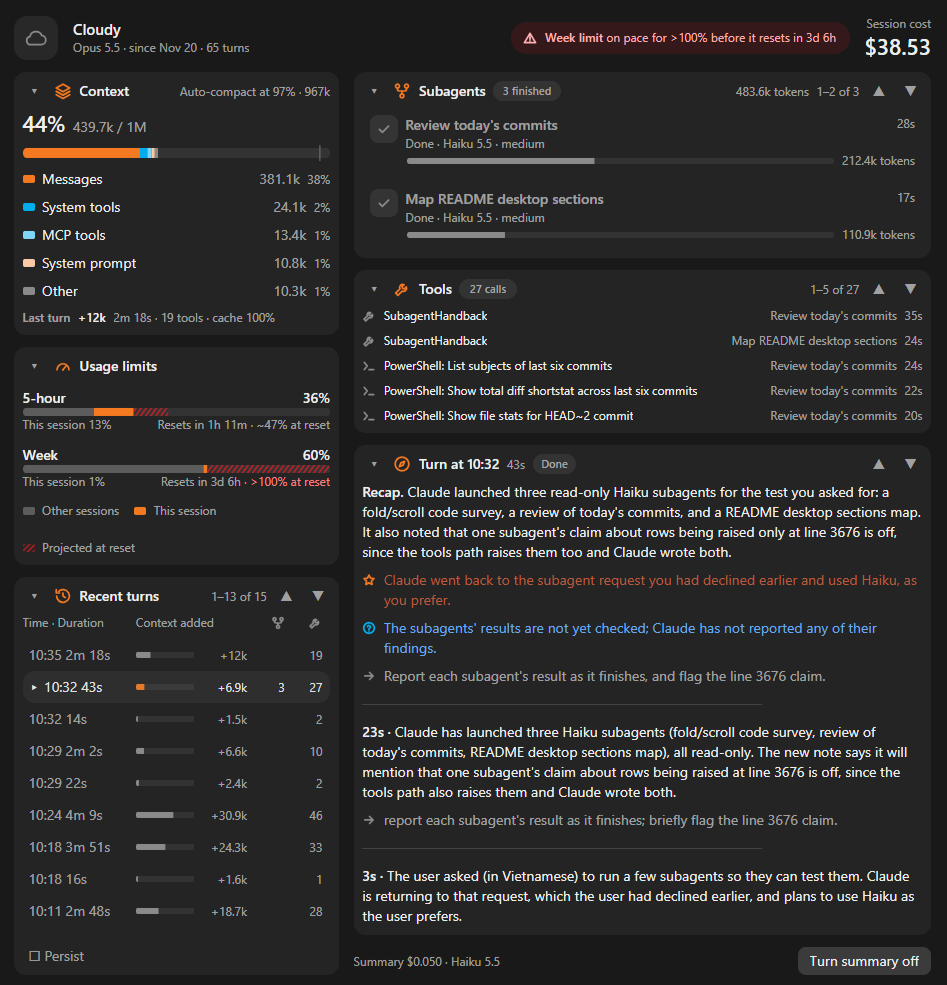

# Claude Code mods

Mods for Claude Code: plugins of function hooks that change Claude Code's own
interface. This folder is a plugin marketplace, `ddt313-mods`, holding one mod
so far.

| Mod | What it does |
| --- | --- |
| [session-weather](session-weather) | A pane with the session's weather: how full the context is, the last turn, the 5-hour and weekly limits and this session's part of each, the cost, how many subagents work, and a running Haiku summary of what Claude is thinking. On the desktop, cards that fold add a row for each subagent (what it is at, its model, the tokens it read and wrote), the turn's tool calls and the recent turns, any of them to look back at; a wide pane adds the limits' pace and what fills the context. While the pane is not on screen, a status line under the prompt keeps its key figures. |

## Session Weather

The pane opens beside the conversation when a session starts.
`/session-weather` opens it again after you closed it. While it is closed,
or the terminal is too narrow to show it, a status line under the prompt
keeps its key figures.

The thinking summary needs Claude's thinking, which Claude Code passes on
only while the session's **Transcript view** is **Thinking** or **Verbose**.
In the Normal view it has little or nothing to summarize: the card reads
`No thinking notes yet: they come only with the Thinking or Verbose
transcript view.` once the turn has done something. Switch the view and the
next prompt's thinking comes through.

The pane lays itself out by its width, and changes over as you drag it wider
or narrower.


Under 90 columns on the desktop, here with a turn of three subagents picked
from the recent turns: the sky, the session's line and its cost across the
top; a tile each for the context, the 5-hour limit and the weekly one; the
warning that the week is on pace to run out; the last turn; the subagents,
the tools and the recent turns, each folded to its top line and its gist
(`3 finished`, `27 calls`, `15 turns`); and the thinking summary of the turn
picked, its recap on top, taking the height they leave (see **On the
desktop**). The terminal draws no images and keeps rows of text at that
width: the weather on top (the sky, the context's fill and where
auto-compact runs, the last turn, the 5-hour and weekly limits with this
session's part of each in yellow, the session's cost), then Haiku's updates
on Claude's thinking, newest first, each with its gist, a decision (★), what
Claude takes as true unchecked (?) and its next step (→).



From 90 columns, here with the same turn picked: the sky, the session's
line, the warning and the cost across the top; on the left, what fills the
context, the limits (each with the pace it is on, `~47% at reset` or
`>100% at reset`) and the recent turns, thirteen of fifteen with ▲ and ▼ to
scroll the rest, the turn picked marked ▸ with its three subagents and 27
tool calls, and the box that persists them under the table; on the right,
the turn's subagents, two of three with all their tokens on the card's top
line, its tool calls newest first, each with the subagent that made it, its
thinking summary, and under it what the summary cost and its switch. Each
card folds by ▾ on its top line. The terminal puts the weather in a column of its own on the left
and the summary beside it (see **Layout** and **Wide layout**).

**Layout**

- From 90 columns wide (character cells; on the desktop, cells of the code
  font) the pane lays out in two, as a web page does on a wide screen: the
  weather in a column of its own on the left, the thinking summary beside it
  with the rest of the width and, in a pane 24 rows tall or more, its whole
  height (on the desktop the subagents' and the tools' cards stand over the
  summary), as in the wide picture. Narrower, the weather stands above the summary, as in the
  narrow one. With the summary off the pane keeps one column at any width.
  Drag the pane wider or narrower and it changes over.
- From 90 columns the weather also says more, in the room its column has:
  see **Wide layout**.
- Minimized to a widget on the desktop app, the pane shows what reads at a
  glance, with no buttons: `☁ Cloudy · 42%`, `5h 30% · Week 74% · $1.23`, and
  the summary's newest update.

**On the desktop**

The desktop app draws the pane as the design "Session Weather layouts" lays
it out: cards on a fill of their own, the bars and icons drawn as images.
The terminal, which draws no images, keeps the rows of text that **Weather**,
**Wide layout** and **Thinking summary** tell. Under 90 columns, from the
top:

- The sky: its icon on a tile of its color, its name (`Showers`), the
  session's line under it (`Opus 5.5 · since 19:59 · 8 turns`), and the
  session's cost on the right.
- A tile each for the context and the 5-hour and weekly windows, side by
  side: the share used, large, over a bar, and two lines under it. The
  context's bar has a mark where auto-compact runs (`compact at 92%`); a
  window's bar shows what the rest of the account used in grey and this
  session's part in orange (`session 10%`, `reset 4h 38m`), and, from a fifth
  of the way into the window, the share its pace would reach by the reset,
  hatched. The wide legend names the grey `Other sessions`.
- A warning, where a window's pace would pass all of it before the reset:
  `Week limit on pace for >100% before it resets in 4d 17h.`
- The last turn in one line: `Last turn +11k 1m 36s · 5 tools · cache 100%`.
- The subagents, as a card, there for a turn that started none too, where it
  reads `No subagents ran in this turn`: how many work and finished, then a
  row each, one at a time here (two from 90 columns), those at work first;
  past that, ▲ and ▼ on the card's top line scroll the rest a row a press,
  beside where the rows stand (`1 of 4`, or `1–2 of 4` from 90 columns).
  Each row: its state's icon, its task and how long it has run; under the
  task its model and effort, led by its state in words unless it runs
  (`Pending`, `Waiting`, `Done`, `Failed`, `Stopped`), and, while it works,
  the context its latest request carried; then, while it works, its latest
  tool call with an icon for its kind; and, once it has tokens, those beside
  a bar of its share of all the subagents' tokens. A row at work stands on a
  fill of its own.
- The tools, as a card under it: the shown turn's tool calls as the wide
  layout lists them (see the tools card below), three at a time here.
- The recent turns, folded here to their top line (`Recent turns 30 turns`
  and **☐ Persist**) until you open them with ▸: then the wide layout's
  table (see below), five turns at a time, ▲ and ▼ scrolling the rest.
  Press a turn, with the summary on, and the subagents, the tools and the
  thinking summary show it, as from 90 columns; the next prompt shows its
  own again. Opened or folded here, it stays so, apart from the wide
  layout's.
- The thinking summary, as a card: the updates of the turn shown (the
  current one, or one picked from the recent turns, titled `Turn at 10:32`)
  as the terminal lists them (see **Thinking summary**), newest first, a rule
  between two; each gist led by its time into the turn (or `Recap.`) in a
  heavier face, and what Claude decided, takes as true unchecked and does
  next each by its icon (a star, a question mark, an arrow), in orange, blue
  and dim. In a pane 24 rows tall or more, ▲ and ▼ scroll them about half the
  window a press, within the turn; they never go to another turn. A shorter
  pane shows the card whole and scrolls itself.
- Under it, what the summary cost and its switch; while the summary is off,
  no card, and `Thinking summary is off` beside **Turn summary on**.

From 90 columns, with the summary on:

- Across the top: the sky and the session's line, the warning where there
  is one, and the session's cost.
- On the left, a column of three cards:
  - The context, on top: its share used and its tokens, a bar of what fills
    it, the four largest parts (messages, system tools and so on) in a color
    each and the rest in grey, with a mark where auto-compact runs, each
    part's tokens and share under it, and the last turn. Past five parts the
    smallest fold together as `Other`.
  - The limits: each window's share used over its bar, this session's part,
    when it resets and where its pace would take it (`~37% at reset`, or
    `>100% at reset` in red), and what the bar's colors mean.
  - The recent turns, as a table: when each began and how long it ran, what
    it added to the context as a bar beside the others' with its tokens
    after it, how many subagents it started (blank for none), and its tool
    calls, these two headed by the icons of their cards on the right; with
    **☐ Persist** under the table (on the top line while the card is
    folded). In a pane 24 rows tall or more it shows as many
    turns as fit, ▲ and ▼ on its top line scrolling the rest a turn a press
    beside where the rows stand (`1–12 of 30`); your next prompt brings the
    newest back to the top. Press a turn to show its updates on the right,
    marked ▸; the next prompt shows its own again.
- On the right: the subagents, with all their tokens on the card's top line;
  the tools; the thinking summary, showing the turn picked, ▲ and ▼ scrolling
  it, and under it what the summary cost and its switch. A turn picked from
  the list shows the subagents it started too, as they last stood (one still
  at work, as it works), the first 30 by when they began and the rest counted
  (`and 2 more not kept`); the current turn shows those listed now.
- The tools card lists the shown turn's tool calls, its subagents' with
  them, newest first, five at a time, ▲ and ▼ on its top line scrolling the
  rest, beside how many it made (`42 calls`) and where the rows stand (`1–5
  of 42`). Under the top line a bar shows where the turn's work went: its
  calls by kind, each kind in a color of its own (Files, Shell, Web, MCP,
  Agents, Skills, Other, by the tool), largest first, by what they added to
  the context once any call has a figure, else by how many. Its legend reads
  how many each kind made and what they added (`Files 4 · +12k`, `~` where a
  share or a call with no figure is in it). Each row: the tool's icon, the
  tool and what it was aimed at (`Read: register.tsx`, a command by its
  description, never its text; an MCP tool as `server: tool`), the
  subagent's task where one made it, its time into the turn, and about how
  much it added to the context (`+42k`). A turn keeps its newest 100 calls,
  the rest counted (`and 3 earlier not kept`); one that made none reads `No
  tools called in this turn`.

  The figure is an estimate. Claude Code tells the mod how large the context
  was that each model request was answered over, and a call's result goes
  with the next request, so the context's growth from one request to the next
  goes on the calls the first made. The growth also holds the model's own
  words and what a hook added. So:

  - A call gets its figure once the next request is answered, not as it ends.
  - Two or three calls of one request share its growth evenly, marked `~`
    (`~+14k`); more get none, as a large read and a short command would read
    alike.
  - A turn's last calls, or those of a request that was cut, get none, nor do
    those before a compaction: a context that shrank puts nothing anywhere.
  - A subagent's calls get none: they fill a context of its own, which Claude
    Code does not report. What its result added shows on the main loop's
    `Agent` call.
- With the summary off, the cards stand in one column (the context, the
  limits, the subagents, the tools, the recent turns): the thinking card is
  gone, the turns are figures alone, and the footer reads `Thinking summary
  is off` beside **Turn summary on**.

The subagents', the tools' and the thinking card each fold to their top
line, and from 90 columns so do the context's, the limits' and the recent
turns': ▾ first on it folds the card, keeping its gist there (`26 calls`,
`45% · 90k / 200k`, `5-hour 3% · Week 25%`, `30 turns`), and ▸ opens it
again. What you fold stays folded, in the next session too. In a pane 24
rows tall or more, the lowest card open in a column takes the height the
others leave: fold the thinking card and the tools card lists as many calls
as fit, fold that too and the subagents' card lists as many subagents; fold
the context or the limits and the recent turns list more turns.

Colors follow the theme where text takes them; the fills, the bars and the
icons are tones that read on a light theme and a dark one alike. The cards
have round corners and the app's own font.

**Weather**

- A forecast from how far the context has filled toward where the engine
  compacts on its own (toward the whole window where it does not): ☀ Clear
  (under 25% of the way), ☁ Cloudy, ☂ Showers, ☇ Storm, ϟ Compact soon (90% of
  the way and up unless you set it otherwise, with a toast once on the way
  up). A 200k window compacts at about 167k, before 90% of the window.
- Tokens used out of the window, a bar, and where auto-compact runs.
- The last turn: the tokens it added, how long it ran, its tool calls, and
  the share of its input the prompt cache served.
- The 5-hour and weekly limits with the time until they reset, kept across
  sessions until the next reading.
- This session's part of each limit, in yellow: `5h 30% · this session 8%`,
  and its cells in the bar, the last of the filled ones (a part under half
  a cell, 2.5 points, has none). The engine reports how much of a window
  the whole account used, never what used it, so each session writes what
  it spends (at API prices, as `/cost` counts it, its summary's Haiku
  requests included) by the minute to a file named after its id in
  `~/.claude/session-weather/spend/`. This session's part is its spend
  since the window began over the spend of every such file, times the
  window's share used, counted again after each response and each minute.
  Spend no file holds (claude.ai, the Claude apps, another computer, a
  session without the mod) counts toward the sessions here in proportion,
  so the part shown is then too high: so it is for a while after the files
  begin, until a window has run its whole length since (5 hours, a week)
  and holds no spend from before them. A session the mod first counts
  mid-way, as when it loads into one already running, spreads what it
  spent until then evenly over its life so far. Off a subscription no
  window has a reading, and nothing is written. The files are a few
  kilobytes each; one last written before the week began is no longer read,
  and the clean-up (see **Old files**) deletes it in time.
- The session's cost at API prices, as `/cost` reports it.
- While the main loop has subagents at work, or has had some finish since
  your prompt, how many of each: `Subagents · 2 at work · 1 finished`. From
  90 columns each has rows of its own (see **Wide layout**).

**Wide layout**

From 90 columns the weather says more, in what was the empty part of its
column. That goes by the pane's width alone: with the summary off the pane
keeps one column, and these stand in it, as wide as the pane. Narrower than
90 columns, minimized to a widget, and on the status line, none of it shows,
and the pane is drawn again no more often than before while nothing happens.
Each row is cut to the column, never wrapped.

- The pace of each limit. A `│` on the bar marks how much of the window's
  time has gone: a fill past it runs ahead of the window, one short of it
  behind. Beside the bar, where the share used would stand at the reset at
  this pace: `~84% at reset` for a week 75% used with 89% of it gone, or
  `>100% at reset` where it would run out first. Under a fifth of the way
  into a window a few points say little, and the bar has the mark alone.
- What fills the context, under the auto-compact line, as the branches of a
  tree: the largest of the rows `/context` counts as in use, each with its
  share of the window (`├ Messages 52.1k · 26%`, the system tools, the system
  prompt…), five rows at most: past five, the largest four and the rest in
  one row, `└ Other`. Never the free space, the compaction buffer or the
  tools loaded on demand. Estimated locally, with no request, and read
  again where the auto-compact point is: at each turn's end, and after a
  compaction.
- The session's line, in place of its cost: `Fable 5.2 · since 09:12 · 23
  turns · 2 compactions · $16.17`, the model, when the session began (the
  day, for one begun before today), the prompts it has had as Claude Code
  counts them, its compactions and its cost, in two rows where one is too
  short. When it began rather than how long it has run: the pane is not drawn
  again while nothing happens, and a running time would go stale. Claude
  Code keeps no count of compactions, so the mod counts those it sees; in a
  session it loaded into part-way (enabled or installed mid-session, or a
  resumed one) it reads `1+ compactions`, there may have been more before. A
  `/clear` starts the session, and the count, over.
- The subagents, under the line that counts them: five at most, the rest
  said in one (`and 3 more`), those at work first, then those that finished,
  the latest first. Each one's row has its task's description, where it
  stands (`pending`, `running`, `waiting`; once ended `done`, `failed` or
  `stopped`) and how long it has run, to the minute, or once ended how long
  it ran (neither for one started before the mod loaded). Under it, while it
  works, its latest tool call in a few words (`Read: ProductList.tsx`, a
  command by the description Claude gave it), then its figures: the model of
  its latest request and the effort it asked for, the tokens its requests
  read and wrote (its own subagents' included), and while it works the
  tokens its latest request carried, `Opus 5.5 · high · 222.3k tokens · ctx
  29.3k`.
  - Tokens, not dollars: the engine reports what the session cost, never
    what one subagent did.
  - The figures are taken in at most once a second, so subagents at work
    draw the pane no more often than that. Where the mod missed some of a
    subagent's own requests (it loaded part-way through), its own count is,
    as it ends, what its turn says it read and wrote; its subagents' stay as
    counted.
  - One that finished stays until your next prompt; a subagent's hand-back
    is none. One still at work stays past it. Each turn of the recent turns
    keeps those it started, 30 at most, which the desktop shows again for a
    turn pressed (see **On the desktop**).
  - Only those the main loop started, a forked skill's run among them, not
    a plugin's or the engine's own; listed again as one starts or ends, each
    minute, and every ten seconds while a turn runs or waits with the summary
    on.
- The recent turns, newest first: your last ten prompts' turns (the newest
  ten of those kept, thirty unless set lower; the desktop scrolls them all),
  a subagent's hand-back going on with the prompt it answers. When each began,
  how long it ran (or that it runs, or waits on its subagents), the tokens it
  added to the context, its tool calls (its subagents' included), and
  whether you interrupted it. Press one to show its updates beside the
  weather (`🧭 Turn at 14:32 · 2m 14s · done`), marked ▸: the current turn
  shows until you press another, and your next prompt shows its own again.
  With the summary off they are figures alone. A pane too short for them all
  leaves the oldest out.
- The recent turns are kept with the session's other values, each with its
  figures and its newest 100 updates: reloading the mod keeps them, and a
  `/clear` starts the list over with the new conversation. Closing Claude
  Code loses them, unless you persist the session: **☐ Persist**, a box
  with the list (in the terminal beside its header; on the desktop under the
  table, or on the card's top line folded), unticked until you press it, and for this session
  alone. Ticked, **☑ Persist**, the session's turns (as many as the list
  keeps, no more, each with the subagents it started and its tool calls)
  and its count of compactions go to a file named after the session's id in
  `~/.claude/session-weather/turns/`, written again as each turn ends or gets
  an update. When the session starts again, after a restart or resumed, they
  come back, the box still ticked; a turn the restart cut short reads
  `interrupted`, and a subagent at work then, `Stopped`. Unticked, the file is
  deleted at once, and the turns stay in memory only, until Claude Code
  closes. Each press brings a toast naming the file: where the turns are
  saved, or that it is deleted. A session never ticked writes no such file.

**Status line**

- While the pane is not on screen, one line under the prompt carries the
  weather's key figures: `☁ 42% · 5h 30% (4h 38m) · $1.23 · 2 subagents`,
  the forecast (from how far the context has filled toward compaction, as in
  the pane) and the share of the context used, the 5-hour limit's share used
  and the time until it resets, the session's cost, and how many subagents
  the main loop started are at work.
- It shows while you have closed the pane, and while the pane waits undrawn
  on a terminal too narrow for it: a pane the session opens on its own is
  placed only from 144 columns, or from 110 once you opened it yourself and
  have not closed it since.
- It goes as soon as the pane is drawn: `/session-weather` opens the pane
  at any width, and a terminal widened enough places it (the line goes at
  its first drawing, or at the latest within a minute).
- It follows the readings: each response, a compaction, a `/clear`, a
  subagent that starts or ends, and the countdown, minute by minute. It is
  set again only when its text changes.
- A part with nothing to show yet is left out rather than shown as zero:
  the context before the first response and right after a compaction, the
  5-hour limit off a subscription (and past its reset, until the next
  reading), the cost before anything is spent or where Claude Code keeps
  no cost, the subagents while none is at work. The weekly limit stays in
  the pane. With no part at all there is no line.

**Thinking summary**

- Reads the main loop's thinking blocks as they stream (subagents left out)
  and has Claude Haiku 5.5 sum them up in a few lines: what is new in what
  Claude is doing, the decisions it made (★), what it takes as true without
  having checked it (?), and what it says comes next (→).
- At most one Haiku request every 15 seconds (a setting) while new notes
  arrive. A long stretch of thinking does not wait for its end: what it
  wrote since the last request (200 characters or more, cut at a sentence's
  end) is read while it goes on, each note with its time into the turn. Each
  request also carries:
  - the last thousand characters or so of what the previous update read, so
    Haiku can follow where the new notes pick up;
  - the main loop's tool calls since the last update, in a few words: a
    command by the description Claude gave it, never its own text, and a
    file by its name alone;
  - what Claude wrote to you since the last update, which the update leaves
    out: you have read it.
- An update tells only what is new since the earlier ones, and says so when
  Claude changes course. With nothing new yet (Claude only begins a thought,
  still weighs its options, or goes over what was reported) Haiku replies
  WAIT: the pane says what it waits for (`Waiting: …`, or `Đợi thêm: …`
  while the summary is in Vietnamese), and those notes go again with the
  next ones. After three times the gap between requests
  without an update (45 seconds by default), and for the turn's recap, WAIT
  is not allowed.
- The prompt's earlier updates stay, newest first, in their own window under
  the weather, or beside it in a wide pane. A recap closes a turn that had two updates or more since the
  last recap, or that ended with notes no update read. A new prompt of yours
  starts the list over; the recent turns bring an earlier one's back (on
  the desktop at any width, in the terminal from 90 columns).
- A turn that a subagent's result begins (its hand-back, which the engine
  delivers as another Claude session's message) or a background task's
  notification is no new prompt: its updates join the list of the prompt
  Claude works on. A turn that ends while subagents it started still work
  is not done: the header says `waiting for 2 subagents`, the clock runs
  on, and one update says where Claude stands (no WAIT: nothing more comes
  until a result does). The recap waits for the turn that ends with none
  left at work, and reads the whole of it from your prompt. Should no
  result wake Claude within about half a minute of the last subagent
  ending (a hand-back withheld, a subagent stopped), the turn is done
  there. A notification after the turn ended, as from a background command
  that finished, opens it again.
- To scroll the updates and nothing else, click ▲ ▼: each click moves about
  half the window, and a line scrolled part-way shows from there, marked `…`.
  The mouse wheel does not reach the updates (the desktop scrolls the pane
  itself with it), nor do the keys, and holding an arrow down does not scroll
  (the desktop draws the pane again only when the press ends).
- The summary needs the session's **Transcript view** set to **Thinking**
  (or Verbose): only then does Claude Code pass on Claude's reasoning, from
  the next prompt on. In the Normal view at most the short notes Claude
  writes between tool calls arrive, often none, and the card stays all but
  empty. A turn that called tools, wrote to you or ended with no thinking
  note says so: `No thinking notes yet: they come only with the Thinking or
  Verbose transcript view.` (`No thinking notes this turn: …` once ended).
- Each turn's updates also go to a log of the session's own, a Markdown
  file named after the session's id in `~/.claude/session-weather/thinking/`
  (under `CLAUDE_CONFIG_DIR` when that is set). A turn's section says when
  it began and how it ended (or that it waits for its subagents), then your
  prompt, the recap, and the updates in the order they came, those of the
  turns its subagents' results began among them. It is written again as
  each update comes, a recap that lands after your next prompt still goes
  to its turn, and a resumed session goes on in the same file. A turn with
  no update adds nothing.
- Claude reads the log through a tool of the mod's,
  `mcp__session-weather__thinking_log`, kept behind ToolSearch until it is
  wanted: the recaps of the last 10 turns by default, up to 50 turns, or
  every update with `full`. Its description tells Claude that the log is
  Haiku's paraphrase of its summarized thinking, to check against the code
  or the transcript, not a record of what it decided.
- A turn takes a kilobyte or two of the log. The file API reads and writes
  no file past 4 MiB, so past 3 MiB a session's thinking log leaves its
  oldest turns out. The clean-up (see **Old files**) deletes a log nothing
  has written for 30 days.
- The summary is written in English unless you set another language.
- Each update or WAIT is one Haiku request on the session's own account,
  about $0.001; the pane shows what the summaries cost this session. Claude
  Code counts each in the session's cost, as it counts any mod's requests,
  so that cost, and this session's part of each limit, already hold them.
  The request carries your prompt, Claude's thinking notes, its tool calls in
  a few words and what it wrote to you. **Turn summary off** stops the
  requests, and the choice is kept across sessions.
- To see what the summary sends Haiku, `/session-weather-debug` turns on its
  debug log, kept on in later sessions until you run the command again. Each
  request goes as sent, with Haiku's reply as it came, to a Markdown file
  named after the session's id in `~/.claude/session-weather/debug/`, the
  system prompt at its top and the newest 30 requests kept; each also leaves
  a dim line in the transcript, which Claude is not sent. The pane's footer
  says `debug log on` while it is. The file holds your prompts and Claude's
  thinking notes, and stays until the clean-up deletes it, or you do.

**Old files**

The mod's files under `~/.claude/session-weather/` (the thinking and debug
logs, the spend files and the saved turns) are deleted once nothing has
written them for 30 days, a setting; 0 keeps them all. The mod looks as a
session starts, and once a day while it runs, and leaves the session's own
files, files of other kinds and links alone. Its file API deletes nothing,
so a command does: PowerShell on Windows, which reads the paths on its
input, `rm` elsewhere. A saved session left unopened that long loses its
saved turns too.

**Settings**

Five rows in `/config`, kept in settings.json under
`pluginConfigs["session-weather@ddt313-mods"].options`. A change there takes
effect at once: Claude Code loads the mod again with the new value, as
`/reload-plugins` would. The pane and the turn's updates stay; a Haiku request
under way is dropped, and the next one is asked on the new terms. The
desktop app shows the same five in the plugin's Settings and keeps them in
the same place; set there, a value is used by the sessions started after it.

- **Thinking summary language** (`summaryLanguage`, default `English`):
  the language Haiku writes the updates and recaps in, named as you would to
  a person (`Vietnamese`, `Japanese`, …). The mod tells Haiku to write in it
  and translates nothing itself: the pane's own labels are English, and its
  word for a WAIT is `Đợi thêm` only while the language is Vietnamese (also
  written `Tiếng Việt` or `vi`), `Waiting` for any other. The thinking log
  tool's description and the debug log's system prompt name the language
  too. Updates written before a change stay in their language. A blank value
  is the default; a long one is cut to one line of 40 characters.
- **Seconds between summary requests** (`summaryGapSeconds`, default 15): at
  most one Haiku request this often while a turn runs, from 5 to 120. WAIT
  is taken away after three of these without an update, and a recap that
  failed is asked again after one, 30 seconds at most.
- **Compact soon at** (`compactSoonPercent`, default 90): how far toward
  compaction, in percent of the way, the forecast turns to ϟ Compact soon,
  the toast warns and the status line's sky turns ϟ. The bands under it stay
  at 25, 50 and 75, so it runs from 76 to 100: Storm keeps at least 75.
- **Delete the mod's old files after (days)** (`cleanupDays`, default 30):
  the days after which a file of the mod's that nothing has written since is
  deleted (see **Old files**), from 0 to 3650; 0 keeps every file.
- **Recent turns kept** (`recentTurns`, default 30): how many of your latest
  turns the desktop's card lists, ▲ and ▼ scrolling them (the terminal the
  newest ten), and a persisted session's file keeps, from 1 to 30; the
  oldest go past it. Each keeps up to its newest 100 updates, 30 subagents
  and 100 tool calls.

A number outside its range is held to the range, never refused: as you set
it in `/config`, where the row then shows the value in use, and as the mod
loads one that settings.json holds from an edit by hand. The manifest
declares no minimum or maximum, which would keep the mod from loading over
such a value. A value of the wrong type there (text for a number) still
does: Claude Code then names the field.

## Install

```
claude plugin marketplace add <path to this folder>
claude plugin install session-weather@ddt313-mods
```

A marketplace that is a folder is read from that folder: edit a mod, then
run `/reload-plugins` in a session to load the change, with no new version
and no reinstall.

## Develop

```
claude plugin test session-weather
claude plugin validate session-weather
```

- `session-weather/hooks/register.tsx`: the hooks module, which
  `hooks/hooks.json` names. It holds the hooks; what they do is in the files
  beside it, one area each: the context, the limits, the spend, the status
  line, the thinking summary (`summary/`), its log and debug log, the recent
  turns, the subagents and the mod's files, and the desktop pane's look,
  cards and layouts (`ui/`).
- `session-weather/types/index.d.ts`: the contract of the values the mod
  keeps in `$.state`.
- `session-weather/tests/`: the tests, a file for each area, and
  `helpers.tsx`, the engine and readings they share.

Two rules of the engine shape how the code is split:

- A function that takes `$` and lives in a file other than `register.tsx` is
  a `function` declaration, not an arrow: past an import, the engine follows
  `$` only into a declaration.
- Each file that reads or updates a value in `$.state` writes that value's
  atom itself, as the engine's scan reads it only there. The shape tags of
  `thinking` and `recentTurns` are in `hooks/atoms.ts`.

Claude Code writes the API's type declarations into
`session-weather/.claude-plugin/types/` when it loads the mod; they are not
committed.

## License

MIT, see [LICENSE](LICENSE).
