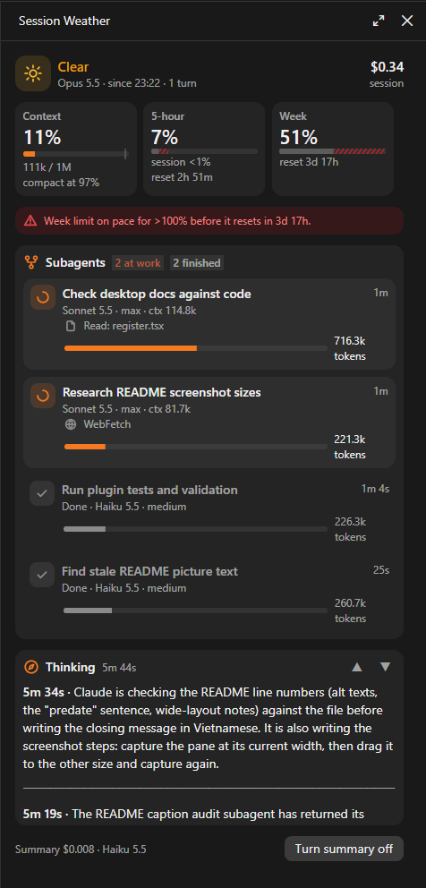

# Claude Code mods

Mods for Claude Code: plugins of function hooks that change Claude Code's own
interface. This folder is a plugin marketplace, `ddt313-mods`, holding one mod
so far.

| Mod | What it does |
| --- | --- |
| [session-weather](session-weather) | A pane with the session's weather: how full the context is, the last turn, the 5-hour and weekly limits and this session's part of each, the cost, and a running Haiku summary of what Claude is thinking. While the pane is not on screen, a status line under the prompt keeps its key figures. |

## Session Weather

The pane opens beside the conversation when a session starts.
`/session-weather` opens it again after you closed it. While it is closed,
or the terminal is too narrow to show it, a status line under the prompt
keeps its key figures.



The pane in the desktop app, 42 seconds into a turn: the weather on top,
then Haiku's updates on Claude's thinking, newest first, each with its gist,
a decision (★), what Claude takes as true unchecked (?) and its next step
(→).

**Layout**

- From 90 columns wide (character cells; on the desktop, cells of the code
  font) the pane lays out in two, as a web page does on a wide screen: the
  weather in a column of its own on the left, the thinking summary beside it
  with the rest of the width and the pane's whole height. Narrower, or with
  the summary off, the weather stands above the summary, as in the picture.
  Drag the pane wider or narrower and it changes over.
- Minimized to a widget on the desktop app, the pane shows what reads at a
  glance, with no buttons: `☁ Cloudy · 42%`, `5h 30% · Week 74% · $1.23`, and
  the summary's newest update.

**Weather**

- A forecast from how far the context has filled toward where the engine
  compacts on its own (toward the whole window where it does not): ☀ Clear
  (under 25% of the way), ☁ Cloudy, ☂ Showers, ☇ Storm, ϟ Compact soon (90% of
  the way and up unless you set it otherwise, with a toast once on the way
  up). A 200k window compacts at about 167k, before 90% of the window.
- Tokens used out of the window, a bar, and where auto-compact runs.
- The last turn: the tokens it added, how long it ran, its tool calls, and
  the share of its input the prompt cache served.
- The 5-hour and weekly limits with the time until they reset, kept across
  sessions until the next reading.
- This session's part of each limit, in yellow: `5h 30% · this session 8%`,
  and its cells in the bar, the last of the filled ones (a part under half
  a cell, 2.5 points, has none). The engine reports how much of a window
  the whole account used, never what used it, so each session writes what
  it spends (at API prices, as `/cost` counts it, its summary's Haiku
  requests included) by the minute to a file named after its id in
  `~/.claude/session-weather/spend/`. This session's part is its spend
  since the window began over the spend of every such file, times the
  window's share used, counted again after each response and each minute.
  Spend no file holds (claude.ai, the Claude apps, another computer, a
  session without the mod) counts toward the sessions here in proportion,
  so the part shown is then too high: so it is for a while after the files
  begin, until a window has run its whole length since (5 hours, a week)
  and holds no spend from before them. A session the mod first counts
  mid-way, as when it loads into one already running, spreads what it
  spent until then evenly over its life so far. Off a subscription no
  window has a reading, and nothing is written. The files stay until you
  remove them, a few kilobytes each; one last written before the week
  began is no longer read.
- The session's cost at API prices, as `/cost` reports it.

**Status line**

- While the pane is not on screen, one line under the prompt carries the
  weather's key figures: `☁ 42% · 5h 30% (4h 38m) · $1.23`, the forecast
  (from how far the context has filled toward compaction, as in the pane)
  and the share of the context used, the 5-hour limit's share used and the
  time until it resets, and the session's cost.
- It shows while you have closed the pane, and while the pane waits undrawn
  on a terminal too narrow for it: a pane the session opens on its own is
  placed only from 144 columns, or from 110 once you opened it yourself and
  have not closed it since.
- It goes as soon as the pane is drawn: `/session-weather` opens the pane
  at any width, and a terminal widened enough places it (the line goes at
  its first drawing, or at the latest within a minute).
- It follows the readings: each response, a compaction, a `/clear`, and
  the countdown, minute by minute. It is set again only when its text
  changes.
- A part with nothing to show yet is left out rather than shown as zero:
  the context before the first response and right after a compaction, the
  5-hour limit off a subscription (and past its reset, until the next
  reading), the cost before anything is spent or where Claude Code keeps
  no cost. The weekly limit stays in the pane. With no part at all there is
  no line.

**Thinking summary**

- Reads the main loop's thinking blocks as they stream (subagents left out)
  and has Claude Haiku 5.5 sum them up in a few lines: what is new in what
  Claude is doing, the decisions it made (★), what it takes as true without
  having checked it (?), and what it says comes next (→).
- At most one Haiku request every 15 seconds (a setting) while new notes
  arrive. A long stretch of thinking does not wait for its end: what it
  wrote since the last request (200 characters or more, cut at a sentence's
  end) is read while it goes on, each note with its time into the turn. Each
  request also carries:
  - the last thousand characters or so of what the previous update read, so
    Haiku can follow where the new notes pick up;
  - the main loop's tool calls since the last update, in a few words: a
    command by the description Claude gave it, never its own text, and a
    file by its name alone;
  - what Claude wrote to you since the last update, which the update leaves
    out: you have read it.
- An update tells only what is new since the earlier ones, and says so when
  Claude changes course. With nothing new yet (Claude only begins a thought,
  still weighs its options, or goes over what was reported) Haiku replies
  WAIT: the pane says what it waits for (`Waiting: …`, or `Đợi thêm: …`
  while the summary is in Vietnamese), and those notes go again with the
  next ones. After three times the gap between requests
  without an update (45 seconds by default), and for the turn's recap, WAIT
  is not allowed.
- The prompt's earlier updates stay, newest first, in their own window under
  the weather, or beside it in a wide pane. A recap closes a turn that had two updates or more since the
  last recap, or that ended with notes no update read. A new prompt of yours
  starts the list over.
- A turn that a subagent's result begins (its hand-back, which the engine
  delivers as another Claude session's message) or a background task's
  notification is no new prompt: its updates join the list of the prompt
  Claude works on. A turn that ends while subagents it started still work
  is not done: the header says `waiting for 2 subagents`, the clock runs
  on, and one update says where Claude stands (no WAIT: nothing more comes
  until a result does). The recap waits for the turn that ends with none
  left at work, and reads the whole of it from your prompt. Should no
  result wake Claude within about half a minute of the last subagent
  ending (a hand-back withheld, a subagent stopped), the turn is done
  there. A notification after the turn ended, as from a background command
  that finished, opens it again.
- To scroll the updates and nothing else, click ▲ ▼: each click moves about
  half the window, and a line scrolled part-way shows from there, marked `…`.
  The mouse wheel does not reach the updates (the desktop scrolls the pane
  itself with it), nor do the keys, and holding an arrow down does not scroll
  (the desktop draws the pane again only when the press ends).
- Claude Code receives summaries of Claude's reasoning only while the
  session's **Transcript view** is **Thinking** (or Verbose), from the next
  prompt on. In the Normal view only the short notes Claude writes between
  tool calls arrive, so there is less to summarize.
- Each turn's updates also go to a log of the session's own, a Markdown
  file named after the session's id in `~/.claude/session-weather/thinking/`
  (under `CLAUDE_CONFIG_DIR` when that is set). A turn's section says when
  it began and how it ended (or that it waits for its subagents), then your
  prompt, the recap, and the updates in the order they came, those of the
  turns its subagents' results began among them. It is written again as
  each update comes, a recap that lands after your next prompt still goes
  to its turn, and a resumed session goes on in the same file. A turn with
  no update adds nothing.
- Claude reads the log through a tool of the mod's,
  `mcp__session-weather__thinking_log`, kept behind ToolSearch until it is
  wanted: the recaps of the last 10 turns by default, up to 50 turns, or
  every update with `full`. Its description tells Claude that the log is
  Haiku's paraphrase of its summarized thinking, to check against the code
  or the transcript, not a record of what it decided.
- The mod cannot delete files (its file API has no delete), so the logs stay
  until you remove them; a turn takes a kilobyte or two. The file API reads
  and writes no file past 4 MiB, so past 3 MiB a session's thinking log
  leaves its oldest turns out.
- The summary is written in English unless you set another language.
- Each update or WAIT is one Haiku request on the session's own account,
  about $0.001; the pane shows what the summaries cost this session. The request
  carries your prompt, Claude's thinking notes, its tool calls in a few words
  and what it wrote to you. **Turn summary off** stops the requests, and the
  choice is kept across sessions.
- To see what the summary sends Haiku, `/session-weather-debug` turns on its
  debug log, kept on in later sessions until you run the command again. Each
  request goes as sent, with Haiku's reply as it came, to a Markdown file
  named after the session's id in `~/.claude/session-weather/debug/`, the
  system prompt at its top and the newest 30 requests kept; each also leaves
  a dim line in the transcript, which Claude is not sent. The pane's footer
  says `debug log on` while it is. The file holds your prompts and Claude's
  thinking notes, and stays until you remove it.

**Settings**

Three rows in `/config`, kept in settings.json under
`pluginConfigs["session-weather@ddt313-mods"].options`. A change there takes
effect at once: Claude Code loads the mod again with the new value, as
`/reload-plugins` would. The pane and the turn's updates stay; a Haiku request
under way is dropped, and the next one is asked on the new terms.

- **Thinking summary language** (`summaryLanguage`, default `English`):
  the language Haiku writes the updates and recaps in, named as you would to
  a person (`Vietnamese`, `Japanese`, …). The mod tells Haiku to write in it
  and translates nothing itself: the pane's own labels are English, and its
  word for a WAIT is `Đợi thêm` only while the language is Vietnamese (also
  written `Tiếng Việt` or `vi`), `Waiting` for any other. The thinking log
  tool's description and the debug log's system prompt name the language
  too. Updates written before a change stay in their language. A blank value
  is the default; a long one is cut to one line of 40 characters.
- **Seconds between summary requests** (`summaryGapSeconds`, default 15): at
  most one Haiku request this often while a turn runs, from 5 to 120. WAIT
  is taken away after three of these without an update, and a recap that
  failed is asked again after one, 30 seconds at most.
- **Compact soon at** (`compactSoonPercent`, default 90): how far toward
  compaction, in percent of the way, the forecast turns to ϟ Compact soon,
  the toast warns and the status line's sky turns ϟ. The bands under it stay
  at 25, 50 and 75, so it runs from 76 to 100: Storm keeps at least 75.

A number outside its range is held to the range, never refused: as you set
it in `/config`, where the row then shows the value in use, and as the mod
loads one that settings.json holds from an edit by hand. The manifest
declares no minimum or maximum, which would keep the mod from loading over
such a value. A value of the wrong type there (text for a number) still
does: Claude Code then names the field.

## Install

```
claude plugin marketplace add <path to this folder>
claude plugin install session-weather@ddt313-mods
```

A marketplace that is a folder is read from that folder: edit a mod, then
run `/reload-plugins` in a session to load the change, with no new version
and no reinstall.

## Develop

```
claude plugin test session-weather
claude plugin validate session-weather
```

- `session-weather/hooks/register.tsx`: the hooks module.
- `session-weather/types/index.d.ts`: the contract of the values the mod
  keeps in `$.state`.
- `session-weather/tests/register.test.tsx`: its tests.

Claude Code writes the API's type declarations into
`session-weather/.claude-plugin/types/` when it loads the mod; they are not
committed.

## License

MIT, see [LICENSE](LICENSE).
